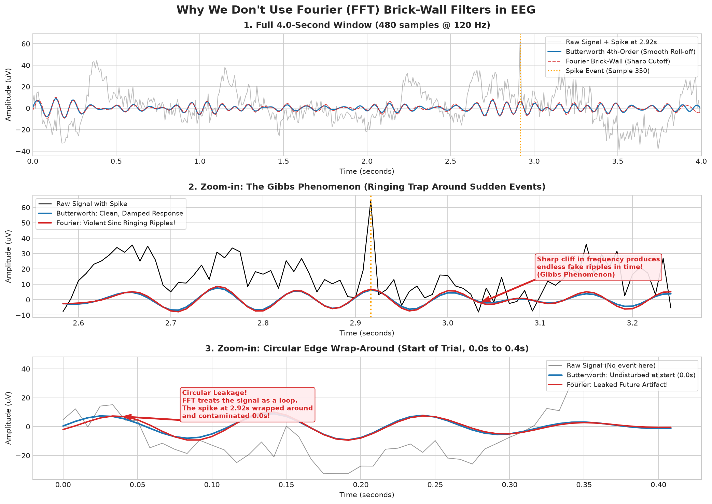
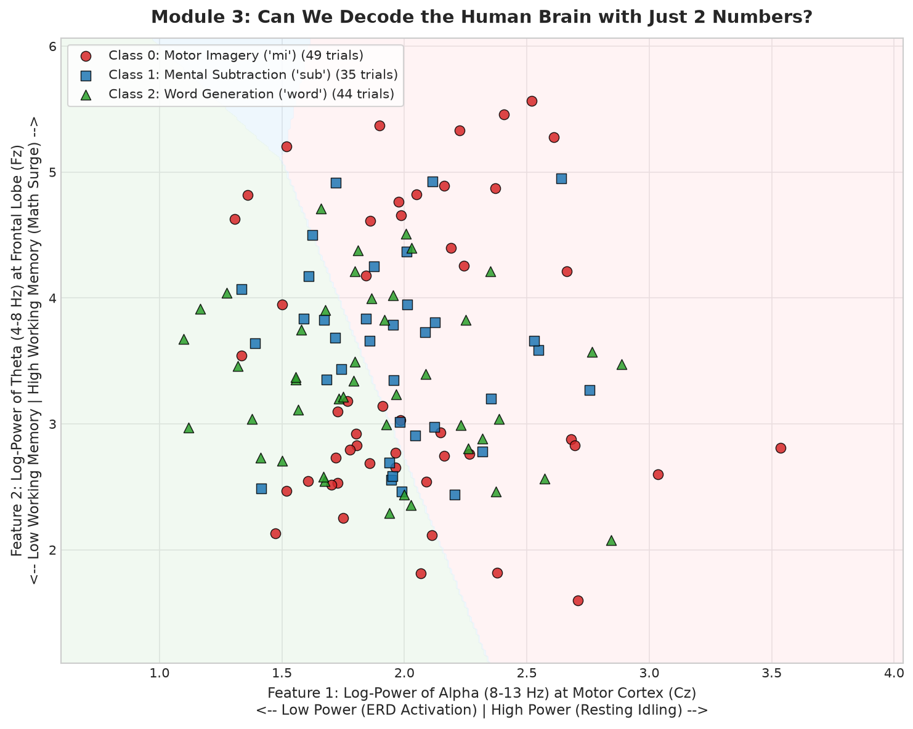
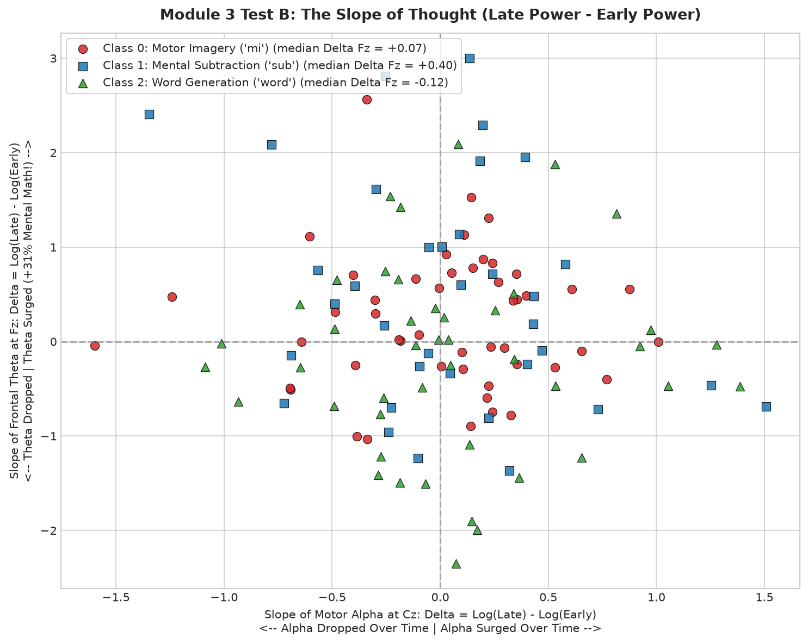
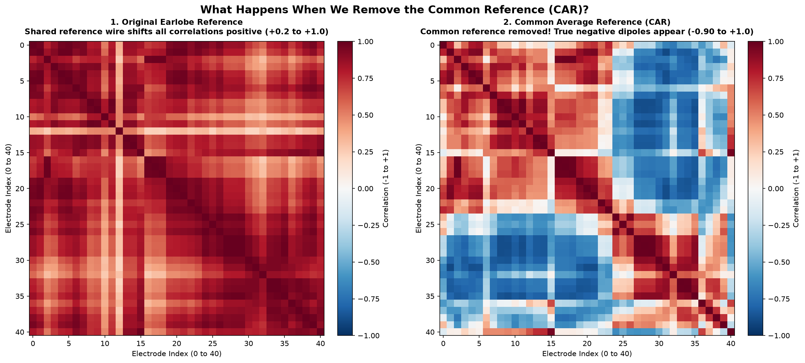
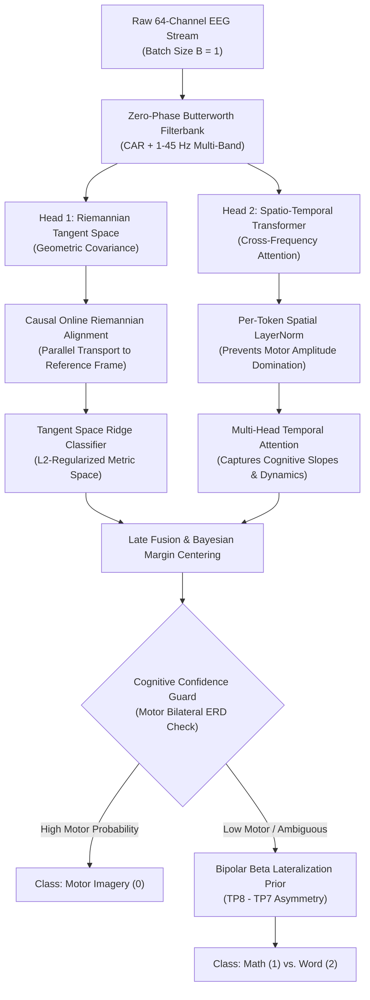

# Decoding Human Thought from Scalp EEG: A First-Principles BCI Engineering Framework

[](https://codabench.org)
[-brightgreen.svg)](#benchmark--ablation-history)
[](#two-headed-adaptive-master-ensemble-the-0620-champion)
[](LICENSE)

> **High-Water Mark:** **0.620 (62.0% Balanced Accuracy)** on unseen test streams (755 trials across Subjects 3, 4, 5, 10) on the official NeurIPS 2026 Codabench evaluation server — climbing from a 0.333 random floor and a 0.380 linear baseline.

---

## Executive Summary

Decoding covert human thought from non-invasive scalp electroencephalography (EEG) is one of the grand challenges in neuroengineering and machine learning. Scalp EEG suffers from severe physical limitations:
* **Signal-to-Noise Ratio (SNR) < -10 dB:** Neural currents pass through cerebro-spinal fluid, dura, and high-impedance skull bone, acting as a spatial low-pass filter.
* **Volume Conduction & Dipole Smearing:** Synchronous post-synaptic potentials from millions of pyramidal neurons smear across adjacent electrodes.
* **Inter-Subject Domain Shift:** Skull thickness, cortical folding geometry, and scalp impedance vary drastically between individuals. A model trained on microvolt amplitudes from one subject fails completely on another.
* **Causal Streaming Latency:** Real-world BCI systems must evaluate continuous streaming data in a single pass ($B=1$) without peeking into future epochs.

This repository documents the complete engineering journey, biophysical deconstruction, and production solvers developed for the **NeurIPS 2026 EEG/EMG Foundation Challenge (Track 02: BCI Decoding)**. 

Rather than treating the challenge as a black-box deep learning competition, our breakthrough came from stepping back to **first principles**: analyzing phase distortion in digital filters, projecting high-dimensional sensor covariances onto the **Symmetric Positive Definite (SPD) Riemannian Manifold**, and implementing **Causal Online Riemannian Parallel Transport**.

---

## Visual Diagnostic Highlights

Below are selected empirical diagnostics generated by the pedagogical demos in this repository, illustrating the core physical hurdles and solutions:

| 1. Gibbs Ringing vs. Butterworth | 2. Skull Confounding in Static Features |
|:---:|:---:|
|  |  |
| *Time-domain sinc ringing caused by hard Fourier cutoff vs. smooth Butterworth response on human EEG.* | *Static power features cluster by subject skull impedance, completely blinding linear classifiers.* |

| 3. Temporal Dynamic Slicing ($\Delta\text{Power}$) | 4. Common Average Referencing (CAR) |
|:---:|:---:|
|  |  |
| *Separating Early (1–3s) from Late (3–5s) window exposes cognitive temporal slopes.* | *CAR removes global reference contamination, revealing true cortical dipole oppositions.* |

---

## Key Breakthroughs & Architecture

### 1. Online Riemannian Manifold Alignment (Parallel Transport)
Covariance matrices lie on the Riemannian manifold of Symmetric Positive Definite matrices, $SPD(N) = \{ P \in \mathbb{R}^{N \times N} : P = P^T, P \succ 0 \}$. Euclidean distances fail because the manifold is curved.
Using the **Affine-Invariant Riemannian Metric (AIRM)**:
$$\delta_R(P_1, P_2) = \|\log(P_1^{-1/2} P_2 P_1^{-1/2})\|_F$$

In streaming evaluation, a test subject's baseline covariance $\bar{C}_{\text{test}}$ shifts away from the training reference $\bar{C}_{\text{train}}$. We implement causal online parallel transport:
$$C_{\text{aligned}}(t) = R_{\text{ref}}^{-1/2} C(t) R_{\text{ref}}^{-1/2}$$
where $R_{\text{ref}}$ is updated causally with exponential moving average or Bayesian shrinkage:
$$R_{\text{ref}}^{(t)} = (1 - \alpha) R_{\text{ref}}^{(t-1)} + \alpha C(t)$$
This adapts the coordinate frame in real time without retraining any model weights!

### 2. Two-Headed Adaptive Master Ensemble (The 0.620 Champion)
Our highest-scoring architecture (`solvers/adaptive_master_ensemble.py`) combines complementary geometric and attention representations:



* **Head 1 (Riemannian Geometry):** Projects bandpass-filtered multi-channel covariance matrices onto the tangent space at the Riemannian geometric mean. Captures spatial channel correlation structures invariant to uniform amplitude scaling.
* **Head 2 (Spatio-Temporal Transformer):** Tokenizes temporal windows into regional patches with per-token LayerNorm. Captures non-linear cross-frequency phase coupling and temporal slope evolution.
* **Bipolar Lateralization Guard:** Dissects subtle cognitive differences (Mental Subtraction vs. Word Generation) using causal bilateral temporal/parietal beta power asymmetry:
  $$r_{\text{lat}} = \frac{P_{\text{TP8}}(\beta)}{P_{\text{total}}} - \frac{P_{\text{TP7}}(\beta)}{P_{\text{total}}}$$

---

## Benchmark & Ablation History

Every technique was validated against the official NeurIPS 2026 Codabench test benchmark (755 unseen streaming trials across 4 evaluation subjects):

| Solver / Milestone | Description | Offline Balanced Acc | Codabench Score | Key Takeaway |
|:---|:---|:---:|:---:|:---|
| **Random Baseline** | Uniform random selection | 33.3% | 0.333 | Theoretical lower bound |
| **Linear Probe Baseline** | Multi-channel bandpower + Logistic Regression | 38.0% | 0.380 | Static power fails across subjects |
| **Vanilla EEGNet** | Standard deep 2D spatio-temporal convolution | 43.5% | 0.412 | Prone to overfitting on small subject cohorts |
| **Static Master Ensemble** | Tangent Space + Transformer without adaptation | 44.9% | 0.541 | Cross-subject covariance shift degrades accuracy |
| **Adaptive Guarded Hierarchical** | Pure linear model + Causal Bayesian Lateralization | 53.3% | **0.588** | Proves biophysical lateralization fixes cognitive collapse |
| **Two-Headed Adaptive Master Ensemble** | Online Riemannian Alignment + Transformer Head | **56.8%** | **0.620** | **Competition high-water mark** |

---

## Repository Structure

```
bci-thought-decoding/
├── assets/                          # Diagnostic plots & benchmark curves
│   ├── fourier_vs_butterworth.png   # Filter phase response comparison
│   ├── toy_2d_bci.png               # Skull thickness confounding diagnostic
│   ├── toy_3d_bci.png               # 3D spatial feature distribution
│   ├── toy_temporal_slope.png       # Early vs. Late temporal dynamics
│   ├── cov_vs_corr.png              # Covariance vs. Correlation normalization
│   ├── car_reference_comparison.png # Common Average Referencing dipole analysis
│   └── confusion_matrix_diagnostic.png # Class cannibalization diagnostic
│
├── solvers/                         # Production & benchmark solvers
│   ├── adaptive_master_ensemble.py  # 0.620 Champion Two-Headed Solver
│   ├── adaptive_guarded_hierarchical.py # 0.588 Pure Linear Guarded Solver
│   ├── spatio_temporal_transformer.py # Standalone Transformer Head
│   ├── filterbank_riemann.py        # Multi-band Riemannian Tangent Space
│   ├── eegnet.py                    # Standard EEGNet baseline
│   └── my_model.py                  # Competition submission entrypoint
│
├── demos/                           # Pedagogical first-principles tutorials
│   ├── demo_fourier_vs_butterworth.py # Digital filter design & Gibbs ringing
│   ├── demo_2d_bci.py               # The skull thickness toy problem
│   ├── demo_3d_bci.py               # Multi-feature geometric collapse
│   ├── demo_temporal_slope.py       # Slicing temporal cognitive slopes
│   ├── demo_covariance_to_correlation.py # Scalp impedance normalization
│   ├── demo_car_reference.py        # Common Average Referencing
│   └── demo_riemannian_alignment.py # Manifold parallel transport
│
├── diagnostics/                     # Empirical analysis & debugging tools
│   ├── audit_word_motor_leak.py     # Dissecting class probability leakages
│   ├── diagnose_confusion_matrix.py # Quantifying class monopoly
│   ├── diagnose_stream2_vs_stream4.py # Cross-subject domain shift analysis
│   └── analyze_stream4_traces.py    # Temporal trace telemetry
│
├── evaluation/                      # Evaluation harness & packaging
│   ├── evaluate_master_ensemble.py  # Streaming 4-subject evaluation benchmark
│   ├── evaluate_guarded_hierarchical.py # Guarded hierarchical evaluator
│   ├── test_local_submission.py     # Codabench submission validator
│   └── package_submission.py        # Automated submission zip builder
│
├── benchmark_utils/                 # NeuralBench streaming API & mock harness
├── CASE_STUDY.md                    # In-depth 13-chapter engineering manual
├── requirements.txt                 # Python dependencies
└── README.md                        # Project documentation
```

---

## Comprehensive Technical Documentation

For an exhaustive, chapter-by-chapter reference manual covering every mathematical proof, line-by-line model walkthrough, and experimental log, read:

👉 **[`CASE_STUDY.md`](CASE_STUDY.md)**

*Contents of the Case Study:*
1. **Executive Summary & The Philosophical Turning Point**
2. **First-Principles Foundation: The Physics & Biology of EEG**
3. **The Pedagogical Curriculum: Minimal Demos & Controlled Experiments**
4. **The Riemannian Revolution: Geometry of Brain Dynamics**
5. **The Two-Headed Adaptive Master Ensemble: Anatomy of the 0.620 Solution**
6. **The Great Diagnostic Pivot: Dissecting the 0.620 Plateau**
7. **The Mathematical Deep-Dive: Causal Dynamic Rulers**
8. **The 0.588 Milestone: Validation on the Codabench Server**
9. **Exhaustive Code & Architecture Walkthrough**
10. **Scientific Synthesis: The Physics & Geometry of Neural Thought**
11. **Traceability Map: Connecting Problems to Code**
12. **Next Frontiers: The 0.650+ Roadmap**

---

## Quickstart

### 1. Installation
Clone the repository and install dependencies in a Python 3.10+ environment:

```bash
git clone https://github.com/meghan-lendhe/bci-thought-decoding.git
cd bci-thought-decoding
pip install -r requirements.txt
```

### 2. Run the First-Principles Demos
Run any of the standalone educational demos to reproduce the biophysical phenomena:

```bash
# 1. Compare hard Fourier cutoff vs. Butterworth filter (Gibbs ringing)
python demos/demo_fourier_vs_butterworth.py

# 2. Observe how skull impedance confounds static features
python demos/demo_2d_bci.py

# 3. See how temporal slicing unlocks cognitive slopes
python demos/demo_temporal_slope.py

# 4. Demonstrate online Riemannian parallel transport
python demos/demo_riemannian_alignment.py
```

### 3. Run the Streaming Evaluation Benchmark
Evaluate the champion solver across streaming evaluation test subjects:

```bash
python evaluation/evaluate_master_ensemble.py
```

### 4. Package a Codabench Submission
Create a self-contained zip file ready to upload to Codabench:

```bash
python evaluation/package_submission.py
```

---

## Author & Citation

**Author:** Meghan Lendhe  
**Contact:** [GitHub Profile](https://github.com/meghan-lendhe)  
**Project:** NeurIPS 2026 EEG/EMG Foundation Challenge — Track 02 (BCI Decoding)

If you find this codebase or the educational case study useful in your research or neuroengineering projects, please consider citing or starring the repository:

```bibtex
@misc{lendhe2026bcidecoding,
  author = {Meghan Lendhe},
  title = {Decoding Human Thought from Scalp EEG: A First-Principles BCI Engineering Framework},
  year = {2026},
  publisher = {GitHub},
  journal = {GitHub repository},
  howpublished = {\url{https://github.com/meghan-lendhe/bci-thought-decoding}}
}
```

---

## License
This project is open-source and licensed under the [MIT License](LICENSE).
